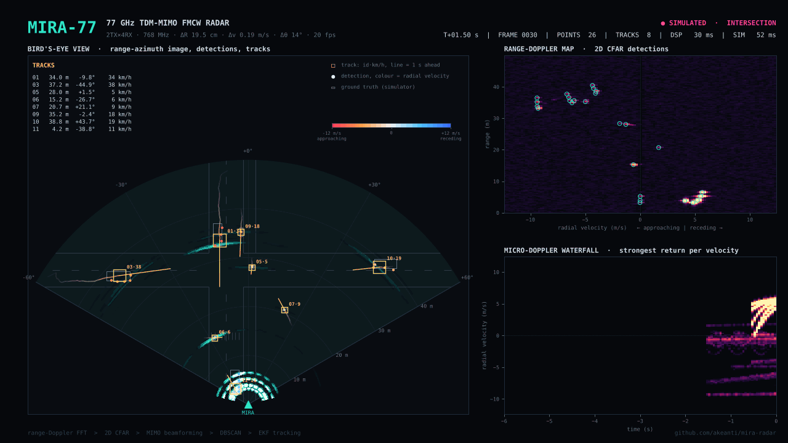
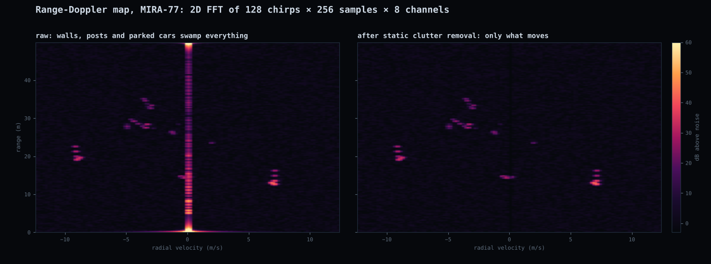
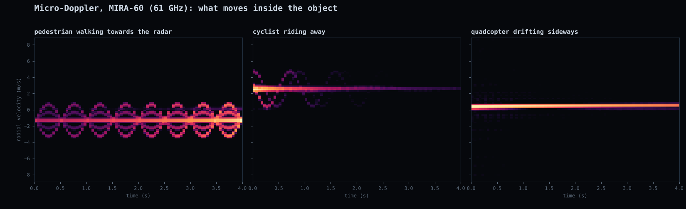
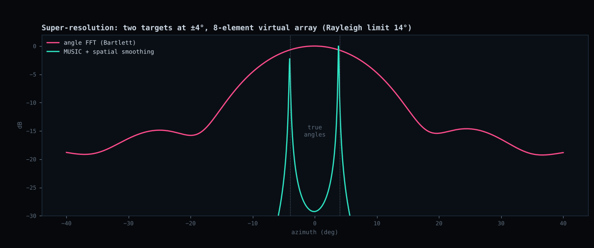
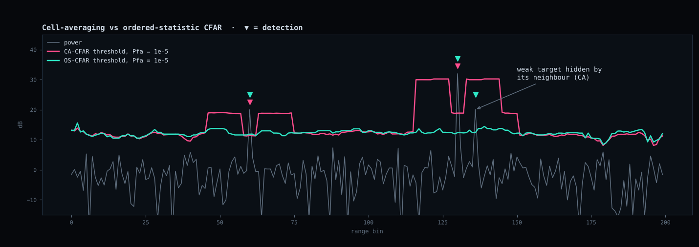
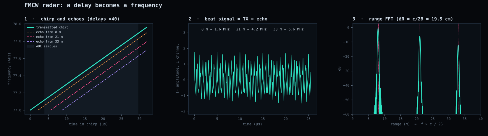
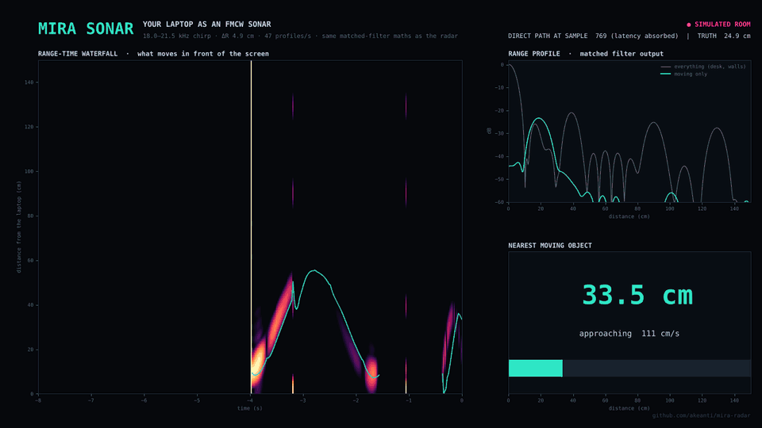

<div align="center">

# MIRA

### A complete 77 GHz MIMO radar, from chirp to track, that runs on your laptop.

Physically accurate FMCW simulator · range-Doppler processing · CFAR · MIMO beamforming & MUSIC · DBSCAN · EKF multi-target tracking · a bit-exact Verilog CFAR core · and a sonar that turns **your laptop's speaker and microphone** into a working FMCW sensor.

[](https://github.com/akeanti/mira-radar/actions/workflows/ci.yml)
[](LICENSE)
[](pyproject.toml)
[](pyproject.toml)
[](hdl/)
[](CONTRIBUTING.md)



<sub>A simulated city intersection: cars (one turning left), pedestrians, a cyclist and a drone, processed frame by frame by the same code that runs live (33 ms per frame). Grey outlines are the simulator's ground truth, amber boxes are what the radar worked out on its own.</sub>

[**Quick start**](#quick-start) · [**How it works**](#how-it-works) · [**Laptop sonar**](#your-laptop-is-a-sonar) · [**FPGA core**](#fpga-cfar-core) · [**Theory**](docs/theory.md) · [**Roadmap**](#roadmap)

</div>

---

Radar is one of those fields where the textbooks stop right before things get interesting and the real code sits inside chip vendors' SDKs. MIRA is the whole chain written out in plain NumPy, readable in an afternoon, with nothing hidden:

- **A radar you can't break.** The simulator produces the raw ADC samples of a TI-AWR1843-class radar, 2 TX × 4 RX, 77 GHz, from a scene of point scatterers with real link budgets (radar equation, antenna pattern, thermal noise, TX→RX leakage, ADC quantisation). Cars light up several range bins and hide their far side, pedestrians swing their limbs, bicycle wheels spin, drone rotors flash.
- **The same processing a real radar runs.** Range FFT → static clutter removal → Doppler FFT → 2D CFAR → TDM-MIMO phase compensation → angle estimation → point cloud → DBSCAN → extended Kalman filter tracking. Every stage is a short file you can open, change and immediately see the effect of in the live console.
- **Measured, not claimed.** 57 tests check every stage against theory: range to a quarter of a bin, SNR against the radar equation, CFAR false alarm rate against its design value, MUSIC beyond the Rayleigh limit, the tracker against ground truth, and the Verilog core bit for bit against its Python model.
- **Hardware you already own.** `mira sonar` plays an 18–21.5 kHz chirp through your laptop speaker and runs the same matched-filter maths on the microphone signal to measure how far your hand is.

## Quick start

```bash
pip install git+https://github.com/akeanti/mira-radar
mira demo                      # the live radar console above
mira demo --scenario indoor    # 60 GHz, people walking in a room
mira sonar                     # your laptop's speaker + mic as a sonar (pip install sounddevice)
mira specs                     # spec sheet of every radar preset
```

Or from a clone: `pip install -e .` then the same commands. Everything also works without a screen: `mira render --out demo.gif demo.mp4` writes the console to a file.

<details>
<summary><b>All commands</b></summary>

| Command | What it does |
|---|---|
| `mira demo [--scenario S] [--angle music] [--cfar os] [--no-truth]` | Live console. Scenarios: `intersection`, `indoor`, `rural`, `two-targets` |
| `mira render --out a.gif b.mp4 [--seconds 8] [--fps 10]` | Render the console to GIF, MP4 or PNG |
| `mira sonar [--audible] [--device N]` | Laptop sonar. `--audible` uses 3–9 kHz for speakers that can't play 20 kHz |
| `mira sonar --simulate` / `--render out.gif` | The sonar on a simulated room and hand, no sound card needed |
| `mira specs [--markdown]` | Range/velocity/angle resolution and limits of each preset |
| `mira bench` | Time every stage of the pipeline |

</details>

## How it works


| Stage | File | The idea in one line |
|---|---|---|
| Simulator | [`simulator.py`](mira/simulator.py) | Each scatterer adds a tone whose frequency is its range, whose phase ramp over chirps is its velocity, and whose phase ramp over antennas is its angle. Separable, so a whole frame is one matrix product. |
| Range-Doppler | [`range_doppler.py`](mira/processing/range_doppler.py) | FFT over fast time gives range, subtracting the mean over chirps deletes everything static, FFT over slow time gives velocity. |
| CFAR | [`cfar.py`](mira/processing/cfar.py) | Threshold = local noise × α, with α solved exactly for the χ² statistics of 8 integrated channels (incomplete beta, no SciPy). Cell-averaging and ordered-statistic. |
| Angle | [`angle.py`](mira/processing/angle.py) | Undo the phase the target gained between TX slots, then beamform the 8 virtual channels. MUSIC with forward-backward spatial smoothing for super-resolution from one snapshot. |
| Tracking | [`tracking.py`](mira/processing/tracking.py) | EKF on [x, y, vx, vy] measuring range, azimuth and radial velocity. Points gated per track with size-aware gates, Hungarian assignment, DBSCAN for births, micro-Doppler and rigid-body aware so a car is one track. |
| Console | [`viz/dashboard.py`](mira/viz/dashboard.py) | Bird's-eye range-azimuth image, range-Doppler map with CFAR hits, scrolling micro-Doppler waterfall. |

The maths behind each step, with figures, is in **[docs/theory.md](docs/theory.md)**.

### Radar presets

Every number below is computed from the chirp parameters in [`config.py`](mira/config.py) (`mira specs --markdown`), change one and the rest follows.

| | **MIRA-77** | **MIRA-77LR** | **MIRA-60** |
|---|---|---|---|
| Use | 77 GHz urban / short-range automotive | 77 GHz long range, narrow beam | 60 GHz indoor / people sensing |
| Carrier | 77.50 GHz | 77.08 GHz | 61.14 GHz |
| Swept bandwidth | 768 MHz | 137 MHz | 1920 MHz |
| Range resolution | 19.5 cm | 109.8 cm | 7.8 cm |
| Max range | 50.0 m | 281.1 m | 15.0 m |
| Velocity resolution | 0.19 m/s (0.70 km/h) | 0.35 m/s (1.24 km/h) | 0.19 m/s (0.67 km/h) |
| Max velocity | ±12.4 m/s (±45 km/h) | ±22.1 m/s (±80 km/h) | ±8.9 m/s (±32 km/h) |
| Antennas | 2 TX × 4 RX = 8 virtual | 2 TX × 4 RX = 8 virtual | 3 TX × 4 RX = 12 virtual |
| Angular resolution | 14.3° at boresight | 14.3° at boresight | 9.5° at boresight |
| Field of view | ±60° azimuth | ±20° azimuth | ±70° azimuth |
| Frame | 128 loops × 256 samples, 20 fps | 128 loops × 256 samples, 20 fps | 96 loops × 192 samples, 20 fps |

## Gallery

<table>
<tr>
<td colspan="2"><br><sub><b>Static clutter removal.</b> Walls, lamp posts and parked cars pile up at zero velocity and bury everything; one subtraction per range bin leaves only what moves. <a href="examples/02_range_doppler.py">examples/02_range_doppler.py</a></sub></td>
</tr>
<tr>
<td colspan="2"><br><sub><b>Micro-Doppler.</b> The torso draws a line, the legs and arms wrap around it at the walking rhythm, the bicycle wheels add a slower fan. <a href="examples/05_micro_doppler.py">examples/05_micro_doppler.py</a></sub></td>
</tr>
<tr>
<td width="50%"><br><sub><b>Super-resolution.</b> Two targets 8° apart, an 8-antenna array whose beam is 14° wide: the FFT sees one blob, MUSIC sees two. <a href="examples/04_angle_music.py">examples/04_angle_music.py</a></sub></td>
<td width="50%"><br><sub><b>CFAR.</b> A strong target raises the cell-averaging threshold and hides its weak neighbour; ordered-statistic CFAR keeps both. <a href="examples/03_cfar.py">examples/03_cfar.py</a></sub></td>
</tr>
<tr>
<td colspan="2"><br><sub><b>FMCW in one picture.</b> The echo is a delayed copy of the chirp, mixing gives a tone at 2SR/c, an FFT turns that into range. <a href="examples/01_fmcw_basics.py">examples/01_fmcw_basics.py</a></sub></td>
</tr>
</table>

## Your laptop is a sonar



<sub>The sonar console on the built-in simulated room (`mira sonar --render`). Run `mira sonar` to see your own hand.</sub>

Same principle as the radar, with sound instead of radio: the speaker loops an 18–21.5 kHz chirp, the microphone hears it bounce off your hand, and a matched filter turns the delay into distance (ΔR = c/2B = 4.9 cm).

Three details make it work on any laptop:

1. **No synchronisation needed.** The chirp is periodic, so any window of one period holds every echo, circularly shifted. One FFT-multiply-IFFT gives the full range profile, wherever the window starts.
2. **Latency cancels out.** The direct speaker→microphone path is always the first big peak, so ranges are measured from it and the unknown audio latency disappears.
3. **Range-Doppler coupling is corrected.** A moving hand Doppler-shifts the echo, which a chirp can't tell apart from a delay (≈6 cm of error at 0.5 m/s). A small Kalman filter estimates the hand's speed and subtracts the bias, exactly what radar trackers do.

> [!NOTE]
> The sonar is tested against a simulated room (fractional delays, real Doppler, arbitrary latency and block sizes; see [`tests/test_sonar.py`](tests/test_sonar.py)). Real laptops differ in how well their speakers and microphones handle 20 kHz. If yours shows nothing, try `mira sonar --audible` (3–9 kHz, you will hear it), and please [open an issue](../../issues) with your laptop model either way so we can build a compatibility list.

## FPGA CFAR core

[`hdl/cfar_ca.v`](hdl/cfar_ca.v) is a streaming cell-averaging CFAR detector in plain Verilog-2005: one sample per clock, two running sums so the cost does not grow with the window, power-of-two training cells so the mean is a shift. It is checked **bit for bit** against its Python model [`mira/hdl_model.py`](mira/hdl_model.py) in Icarus Verilog, with random idle cycles on the input, for several window sizes ([`tests/test_hdl.py`](tests/test_hdl.py)).

Synthesised with Yosys 0.33 (16-bit samples, 2 guard + 8 training cells per side, Q4.4 threshold factor):

| Target | Logic | Flip-flops | Other |
|---|---|---|---|
| Xilinx 7-series (Artix-7) | ~140 LUTs | 442 | 1 DSP48E1, 23 CARRY4 |
| Lattice ECP5 | 107 LUT4 | 442 | 1 MULT18X18D, 58 CCU2C |
| Lattice iCE40 | 511 LUT4 | 442 | 125 SB_CARRY (multiplier in logic) |

Under 1% of an XC7A50T. See [hdl/README.md](hdl/README.md) to simulate and synthesise it yourself.

## Validation

Everything below runs in CI on every push (`pytest`, ~20 s).

| What | Result | Test |
|---|---|---|
| Point targets, 4 at once | range within ΔR/4, velocity within Δv/2, angle within 1.5° | [`test_simulator.py`](tests/test_simulator.py) |
| Link budget | measured SNR = radar equation ± 4 dB (scalloping) | [`test_simulator.py`](tests/test_simulator.py) |
| TDM-MIMO | 11 m/s target: angle wrong without the phase fix, right with it | [`test_simulator.py`](tests/test_simulator.py) |
| CFAR | measured false alarm rate within 0.4–2.5× design, CA and OS | [`test_cfar.py`](tests/test_cfar.py) |
| MUSIC | resolves 8° (Rayleigh limit 14°) in ≥ 90% of trials; FFT in 0% | [`test_angle.py`](tests/test_angle.py) |
| Hungarian, EKF Jacobian | equal to brute force / numerical derivative | [`test_tracking.py`](tests/test_tracking.py) |
| Intersection, end to end | over the 10 s scene: 94% of objects tracked, 0.4 false tracks per frame, 0.5 m mean error | [`test_pipeline.py`](tests/test_pipeline.py) |
| Indoor, end to end | both walkers tracked to ~5 cm (a person sitting still is invisible after clutter removal) | [`test_pipeline.py`](tests/test_pipeline.py) |
| Sonar | steady hand within 1.5 cm after coupling correction; waving hand median error < 3.5 cm for any latency or block size | [`test_sonar.py`](tests/test_sonar.py) |
| Verilog CFAR | bit-exact with the Python model | [`test_hdl.py`](tests/test_hdl.py) |

**Speed.** On a 4-vCPU cloud VM (Xeon 2.8 GHz) the full receive chain takes 33 ms per 77 GHz frame (128 × 8 × 256 complex samples) and 21 ms per 60 GHz frame, inside the 50 ms budget for 20 fps. Simulating the scene costs another 25–60 ms. Run `mira bench` on yours.

## Use it as a library

```python
from mira import Car, FMCWSimulator, Maneuver, Pedestrian, RadarPipeline, Scene, get_preset

cfg = get_preset("MIRA-77")
scene = Scene([
    Car(position=(-3, 45), velocity=(0, -10)),
    Car(position=(20, 20), velocity=(-7, 0), maneuvers=[Maneuver(1.5, 3.6, yaw_rate=0.75)]),
    Pedestrian(position=(4, 12), velocity=(-1.2, 0.3)),
])
sim, radar = FMCWSimulator(cfg), RadarPipeline(cfg)

for _ in range(60):
    result = radar.process(sim.frame(scene), scene.t)   # raw ADC cube in, tracks out
    scene.step(cfg.frame_period)

for t in result.tracks:
    print(t.id, t.position, t.velocity)
```

`result` also carries the range-Doppler map, CFAR threshold, point cloud (range, azimuth, velocity, SNR), clusters and per-stage timings. Feed `RadarPipeline.process` your own `(chirps, channels, samples)` cube to run the chain on recorded data.

## Repository layout

```text
mira/
  config.py            radar parameters and everything derived from them
  scene.py             cars, pedestrians, cyclists, drones, reflectors, static clutter
  scenarios.py         ready-made scenes
  simulator.py         raw ADC data cube from a scene
  pipeline.py          the full receive chain, frame by frame
  processing/          range_doppler, cfar, angle, clustering, tracking
  sonar/               laptop sonar: processor, simulated room, live console
  viz/                 console and GIF/MP4 renderer
  hdl_model.py         bit-exact models of the Verilog cores
hdl/                   Verilog CFAR core and testbench
examples/              one script per concept, each makes a figure in docs/media
docs/theory.md         FMCW radar from first principles
tests/                 57 tests
```

## Roadmap

MIRA is young. Things that would make it better, roughly in order:

- [ ] **Real radar data:** a loader for TI mmWave + DCA1000 raw captures, so the same pipeline runs on an IWR6843 or AWR1843 board
- [ ] Verilog range FFT and a full FFT → CFAR streaming chain with a cocotb testbench
- [ ] Velocity disambiguation with staggered chirp rates
- [ ] Elevation from a 2D virtual array
- [ ] Vital signs (breathing, heartbeat) from the phase of a static person at 60 GHz
- [ ] Track classification from extent and micro-Doppler (car / pedestrian / cyclist / drone)
- [ ] Sonar: gesture recognition, and a compatibility list of laptops
- [ ] A browser version of the console

Ideas and pull requests are very welcome, see [CONTRIBUTING.md](CONTRIBUTING.md).

## Citing

If MIRA helps your course, thesis or paper, a citation is appreciated (GitHub's *Cite this repository* button uses [CITATION.cff](CITATION.cff)).

## License

[MIT](LICENSE). Use it, teach with it, build on it.

---

<div align="center">

Made by [Elmehdi Essamit](https://github.com/akeanti), electrical engineering student at EHTP, Casablanca.<br>
If you learned something, a ⭐ helps other people find it.

[](https://star-history.com/#akeanti/mira-radar&Date)

</div>
